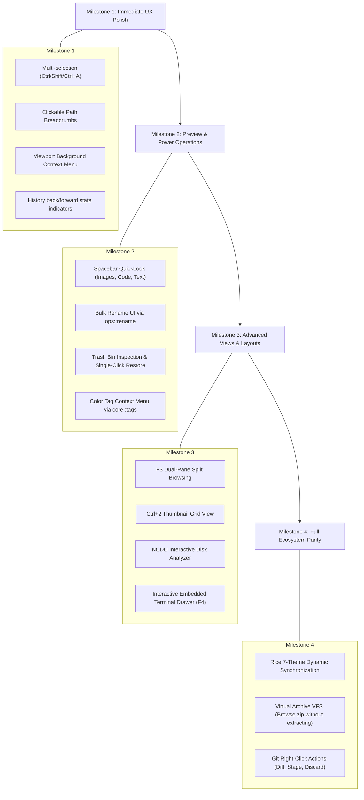

# ⚡ Project Vega: Master Architecture, Blueprint & Future Roadmap

**Document:** `VEGA-BRAIN-MASTER-2026`  
**Repository:** [`/home/baanbhaba/projects/vega`](file:///home/baanbhaba/projects/vega) (`git@github.com:baanbhaba/project-vega.git`)  
**Ecosystem Integration:** Hyprland Rice v2.0, Wayland, Slint 1.9, Rust 2024 Edition  
**Last Updated:** 2026-10-30  

---

## 📌 Executive Summary

**Project Vega** is an ultra-high performance, GPU-accelerated Linux file manager engineered in pure Rust (2024 Edition) and Slint UI. Designed to replace legacy file managers like KDE Dolphin and Nautilus, Vega delivers sub-millisecond streaming directory traversal, zero-dotfile sidecar metadata, native Git status tracking via `libgit2`, and fluid Wayland integration with Hyprland.

This document serves as the persistent brain blueprint for the project, detailing current architectural state, recent mission-critical bug fixes, identified ergonomic bottlenecks, and a concrete phased roadmap for future superpowers.

```
┌────────────────────────────────────────────────────────────────────────┐
│                          VEGA CORE ARCHITECTURE                        │
├────────────────────────────────┬───────────────────────────────────────┤
│         GUI LAYER (Slint)      │  • Window & Layout Virtualization     │
│         Hardware Accelerated   │  • FocusScope & Keyboard Shortcuts   │
│         OpenGL / Vulkan / Skia │  • Context Menus & Modals             │
├────────────────────────────────┼───────────────────────────────────────┤
│         APPLICATION STATE      │  • AppState Mutex & Flume Channels    │
│         src/main.rs            │  • Inotify Watcher Lifecycle          │
│                                │  • History Stack & Nav Controller     │
├────────────────────────────────┼───────────────────────────────────────┤
│         BACKEND ENGINES        │  • scanner.rs (Rayon Parallel Stat)   │
│         src/core/ & src/ops/   │  • git.rs (libgit2 C-FFI Status Cache)│
│                                │  • filter.rs (Nucleo SIMD Matcher)    │
│                                │  • archive.rs (Streaming Tar/Zip/Zst) │
│                                │  • rename.rs (Regex Engine + Previews)│
│                                │  • tags.rs (Hashed JSON Sidecars)     │
└────────────────────────────────┴───────────────────────────────────────┘
```

---

## 🔍 Section 1: Current System State & Verified Fixes

### 1.1 FocusScope Key-Trapping Fix
* **Problem:** In Slint, wrapping the main layout in an outer `FocusScope` caused its `key-pressed` handler to intercept all keystrokes before child widgets could receive them. When typing in the address bar, search bar, or modal dialogs, hitting <kbd>Backspace</kbd> triggered `go-up()`, hitting <kbd>Delete</kbd> trashed files, and hitting <kbd>Enter</kbd> opened files behind the dialog.
* **Resolution:** Added `has-path-focus()` on [`Toolbar`](file:///home/baanbhaba/projects/vega/ui/main.slint) and `has-filter-focus()` on [`Sidebar`](file:///home/baanbhaba/projects/vega/ui/main.slint). `FocusScope.key-pressed` explicitly returns `reject` when any text input has focus or when modal dialogs are active.

### 1.2 Wayland Window Identity (`class: Vega`)
* **Problem:** Slint defaulted to an empty Wayland `app_id`, causing Hyprland's `class:` and `initialClass:` to be blank. This prevented Hyprland window rules, Waybar taskbars, and Rofi from matching `StartupWMClass=Vega`.
* **Resolution:** Registered `slint::set_xdg_app_id("Vega")` immediately following `MainWindow::new()?` in [`src/main.rs`](file:///home/baanbhaba/projects/vega/src/main.rs). Hyprland now correctly identifies Vega with `class: Vega`.

### 1.3 Viewport-Compensated Context Menu Math
* **Problem:** In Slint's `ListView`, items are positioned within a scrolled viewport. Right-clicking an item after scrolling down calculated `ctx-y` using raw item offsets without the viewport offset, pushing the popup menu off-screen or pinning it to the bottom.
* **Resolution:** Updated [`ui/main.slint`](file:///home/baanbhaba/projects/vega/ui/main.slint) to compute:
  $$\text{ctx-y} = \min\left(\max(10\text{px}, 70\text{px} + \text{file-list.viewport-y} + \text{self.y} + \text{my}), \text{root.height} - 360\text{px}\right)$$
  $$\text{ctx-x} = \min\left(\max(10\text{px}, \text{Palette.sidebar-width} + \text{mx}), \text{root.width} - 230\text{px}\right)$$

### 1.4 Debounced Double-Click & Activation
* **Problem:** Slint emits both `clicked` and `double-clicked` on the second press of a double-click. Without synchronization, directory navigation and file execution ran twice concurrently.
* **Resolution:** Introduced a 300ms atomic debounce timestamp (`last_activation`) guarding all entry activations in [`src/main.rs`](file:///home/baanbhaba/projects/vega/src/main.rs).

### 1.5 Modal Dialog Pre-population & Auto-Focus
* **Problem:** The Rename dialog opened blank without the selected file's name and without input focus.
* **Resolution:** Bound `selected-name` on `MainWindow`. When <kbd>F2</kbd> or Context Menu Rename is invoked, `dialog-value` is populated with `selected-name`. Added `init => { self.focus(); self.select-all(); }` to `modal-input`.

### 1.6 Two-Way Path Bar Synchronization
* **Problem:** Using a one-way binding on `path-input.text` broke synchronization as soon as a character was typed.
* **Resolution:** Bound two-way `current-path <=> root.current-path` in [`ui/main.slint`](file:///home/baanbhaba/projects/vega/ui/main.slint). Fixed `collapse_home` in [`src/utils/paths.rs`](file:///home/baanbhaba/projects/vega/src/utils/paths.rs) to return `~` for the home directory instead of `~/`. Filtered `%U` arguments passed by desktop entries.

---

## 🛠️ Section 2: Immediate Architectural Enhancements

### 2.1 Multi-Item Selection Model
* **Current State:** Single index `selected-index: int`.
* **Target Design:**
  * Represent selections as a bitset or `HashSet<usize>` in [`src/main.rs`](file:///home/baanbhaba/projects/vega/src/main.rs).
  * Expose `selected: bool` on each `EntryData` item in `ui/main.slint`.
  * Support keyboard multi-selection:
    * <kbd>Ctrl+A</kbd>: Select all entries.
    * <kbd>Shift+↑ / ↓</kbd>: Range selection from anchor.
    * <kbd>Ctrl+Click</kbd>: Toggle individual entry without clearing others.
    * Click without modifier: Select single entry and clear others.
  * Enable batch operations: Bulk Copy (<kbd>Ctrl+C</kbd>), Bulk Cut (<kbd>Ctrl+X</kbd>), Bulk Trash (<kbd>Del</kbd>).

### 2.2 Clickable Breadcrumb Path Bar
* **Current State:** Plain text input displaying `~/projects/vega`.
* **Target Design:**
  * Default view renders a chain of pill buttons: `🏠 ~` ❯ `projects` ❯ `vega` ❯ `src`.
  * Clicking any breadcrumb pill immediately calls `navigate-to(path)`.
  * Clicking the blank space to the right of the breadcrumbs or pressing <kbd>Ctrl+L</kbd> toggles into standard `TextInput` mode.
  * Pressing <kbd>Esc</kbd> or clicking outside reverts to breadcrumbs.

### 2.3 Viewport Background Context Menu
* **Current State:** Right-clicking blank space in the file view or in an empty directory does nothing.
* **Target Design:**
  * Attach a fallback `TouchArea` behind the file rows.
  * Right-clicking empty space presents a directory-level context menu:
    * 📁 *New Folder* (<kbd>Ctrl+Shift+N</kbd>)
    * 📄 *New File* (<kbd>Ctrl+N</kbd>)
    * 📥 *Paste* (<kbd>Ctrl+V</kbd>) *(active if clipboard has files)*
    * 💻 *Open Terminal Here* (<kbd>Ctrl+T</kbd>)
    * 🔄 *Refresh* (<kbd>F5</kbd>)
    * 👁 *Toggle Hidden Files* (<kbd>Ctrl+H</kbd>)

### 2.4 History Navigation State (Can Go Back / Forward)
* **Current State:** Toolbar buttons ◀ and ▶ have static opacity.
* **Target Design:**
  * Add properties `can-go-back: bool` and `can-go-forward: bool` to `MainWindow`.
  * Compute based on `s.history_idx > 0` and `s.history_idx + 1 < s.history.len()`.
  * Dim disabled buttons (`opacity: 0.35`) and ignore clicks when false.
  * Map mouse thumb buttons (buttons 8 and 9) and <kbd>Alt+Left</kbd> / <kbd>Alt+Right</kbd> to history navigation.

---

## 🚀 Section 3: Killer Feature Specifications

### 3.1 Instant Spacebar QuickLook (Floating Preview Modal)
* **Inspiration:** macOS QuickLook, Yazi image/code preview.
* **Trigger:** Pressing <kbd>Space</kbd> on any selected file toggles the preview. Pressing <kbd>Space</kbd> or <kbd>Esc</kbd> closes it.
* **Architecture:**
  * **Images (`.png`, `.jpg`, `.jpeg`, `.webp`, `.svg`, `.gif`):** Rendered directly in Slint via `Image` element with scaled aspect ratio, accompanied by metadata (pixel resolution, color depth, file size).
  * **Code & Text (`.rs`, `.py`, `.js`, `.json`, `.toml`, `.md`, `.sh`, `.c`):** Read first 300 lines asynchronously. Render in a monospace font with line numbers and syntax token styling.
  * **Archives (`.zip`, `.tar.gz`, `.tar.xz`, `.tar.zst`):** Inspect archive table of contents via `zip` / `tar` readers without extracting to disk; display internal file hierarchy.
  * **Audio (`.flac`, `.mp3`, `.wav`, `.ogg`):** Extract ID3/FLAC Vorbis tags (Artist, Title, Album, Bitrate, Sample Rate) and duration.

### 3.2 Dual-Pane Split Browsing (<kbd>F3</kbd>)
* **Inspiration:** KDE Dolphin, Midnight Commander.
* **Trigger:** Pressing <kbd>F3</kbd> splits the file view into two equal columns (`Pane A` and `Pane B`).
* **Architecture:**
  * Each pane maintains its own `current_dir`, `history`, `entries`, and `selected_index`.
  * Active pane is visually distinguished by an accent border.
  * <kbd>Tab</kbd> toggles active pane focus.
  * Fast Transfer: Pressing <kbd>F5</kbd> copies selected items from the active pane to the target pane's directory. Pressing <kbd>F6</kbd> moves them.

### 3.3 Thumbnail Grid View Mode (<kbd>Ctrl+1</kbd> / <kbd>Ctrl+2</kbd>)
* **Trigger:** Toolbar switch or shortcuts:
  * <kbd>Ctrl+1</kbd>: Detailed List View (current table layout).
  * <kbd>Ctrl+2</kbd>: Grid / Card View.
* **Architecture:**
  * Uses Slint grid layout with fixed cell width (120px–180px).
  * In the background thread pool, generate downsampled thumbnails (e.g. 256x256 WebP or RGBA buffers) cached in `~/.cache/vega/thumbnails/<hash>.png`.
  * Display file name centered beneath the thumbnail card.

### 3.4 Regex Bulk Renaming Dialog
* **Existing Subsystem:** [`src/ops/rename.rs`](file:///home/baanbhaba/projects/vega/src/ops/rename.rs) is already fully implemented with regex pattern parsing, capture groups (`$1`), zero-padded counter placeholders (`{n:03}`), and collision detection.
* **UI Integration:**
  * Select multiple files > Press <kbd>Ctrl+M</kbd> or select "Bulk Rename" from context menu.
  * Modal displays:
    * `Match Pattern`: Regex string (e.g. `IMG_(\d+)`).
    * `Replace With`: Template string (e.g. `Vacation_$1_{n:02}`).
    * `Live Preview Table`: Two columns showing `Original Name` ➔ `Resulting Name` with colored diff highlight.
    * Safety guard: Disallows execution if target names collide.

### 3.5 Built-In Disk Space Analyzer ("NCDU View")
* **Inspiration:** `ncdu`, `baobab`, `dua-cli`.
* **Trigger:** <kbd>Ctrl+3</kbd> or Toolbar Disk Icon.
* **Architecture:**
  * Traverses directory tree recursively in parallel using Rayon.
  * Calculates cumulative subtree sizes.
  * Renders a descending sorted list with proportional horizontal graphical usage bars:
    ```
    [████████████████████] 4.2 GB  projects/
    [████████░░░░░░░░░░░░] 1.8 GB  Videos/
    [████░░░░░░░░░░░░░░░░] 850 MB  Downloads/
    [█░░░░░░░░░░░░░░░░░░░] 210 MB  .cargo/
    ```
  * Double-clicking enters the subdirectory and recalculates immediately.

### 3.6 Color Tags & Kanban Workflow
* **Existing Subsystem:** [`src/core/tags.rs`](file:///home/baanbhaba/projects/vega/src/core/tags.rs) provides zero-pollution deterministic JSON sidecar persistence in `~/.local/share/vega/tags/<hash>.json`.
* **UI Integration:**
  * Context menu option: "🏷 Set Color Tag" (🔴 Red, 🟢 Green, 🔵 Blue, 🟡 Yellow, 🟣 Purple, ⚪ Clear).
  * Displays a colored circular badge indicator next to the file icon.
  * Sidebar filter: "Tags" section allowing one-click filtering to see all tagged items across folders.

### 3.7 Native Git Workflow Integration
* **Existing Subsystem:** [`src/core/git.rs`](file:///home/baanbhaba/projects/vega/src/core/git.rs) uses `libgit2` C-FFI to detect repo roots, branches, and statuses (`Modified`, `Untracked`, `Staged`, `Conflict`).
* **UI Integration:**
  * Right-click on a Git repository file:
    * 🔍 *View Git Diff:* Spawns Kitty running `git diff <file>`.
    * ➕ *Stage File:* Calls `libgit2` `Index::add_path` without external processes.
    * ➖ *Unstage File:* Calls `git reset HEAD <file>`.
    * ↩ *Discard Changes:* Prompts confirmation to revert uncommitted modifications.

### 3.8 Hyprland Rice Theme Synchronization
* **Ecosystem Hook:** The rice ecosystem includes 7 handcrafted aesthetic themes toggled via <kbd>SUPER + SHIFT + T</kbd> ([`theme_switcher.sh`](file:///home/baanbhaba/.config/hypr/scripts/theme_switcher.sh)).
* **Integration Strategy:**
  * Vega sets up an inotify watch on `~/.config/hypr/.theme_current`.
  * When changed, Vega loads the active theme palette and dynamically updates:
    | Theme | Accent Color | Surface Background | Font Family |
    | :--- | :--- | :--- | :--- |
    | **RetroBoy** | `#8bac0f` (GameBoy Green) | `#0f380f` | `VT323` |
    | **Charcoal** | `#e0e0e0` (Minimal Gray) | `#121212` | `Hack` |
    | **NeoBrutalism** | `#ffe600` (Electric Yellow) | `#000000` | `Space Grotesk` |
    | **DarkBrutalism** | `#00ff66` (Matrix Green) | `#0a0a0a` | `JetBrainsMono Nerd Font`|
    | **Jaipur** | `#e2725b` (Terracotta) | `#1a0f0d` | `Cinzel` |
    | **ColorBlock** | `#ff3366` (Bauhaus Pink) | `#181824` | `Space Grotesk` |
    | **Sketchbook** | `#5c7cfa` (Blueprint Blue) | `#1e1e2e` | `Space Mono` |

---

## 🗺️ Section 4: Implementation Blueprint & Milestones



---

## 📁 Key File Index

* **UI Definition:** [`ui/main.slint`](file:///home/baanbhaba/projects/vega/ui/main.slint)
* **Application Controller & Event Loop:** [`src/main.rs`](file:///home/baanbhaba/projects/vega/src/main.rs)
* **Streaming Directory Scanner:** [`src/core/scanner.rs`](file:///home/baanbhaba/projects/vega/src/core/scanner.rs)
* **Real-time Filesystem Watcher:** [`src/core/watcher.rs`](file:///home/baanbhaba/projects/vega/src/core/watcher.rs)
* **Zero-Dotfile Tag & Kanban Store:** [`src/core/tags.rs`](file:///home/baanbhaba/projects/vega/src/core/tags.rs)
* **Nucleo SIMD Fuzzy Filter:** [`src/core/filter.rs`](file:///home/baanbhaba/projects/vega/src/core/filter.rs)
* **libgit2 Status Engine:** [`src/core/git.rs`](file:///home/baanbhaba/projects/vega/src/core/git.rs)
* **Parallel File Operations Pipeline:** [`src/ops/fileops.rs`](file:///home/baanbhaba/projects/vega/src/ops/fileops.rs)
* **Regex Bulk Rename Engine:** [`src/ops/rename.rs`](file:///home/baanbhaba/projects/vega/src/ops/rename.rs)
* **Archive Extract / Compress:** [`src/ops/archive.rs`](file:///home/baanbhaba/projects/vega/src/ops/archive.rs)
* **SIMD & Blake3 Checksum:** [`src/ops/checksum.rs`](file:///home/baanbhaba/projects/vega/src/ops/checksum.rs)
* **Desktop Launcher:** [`~/.local/share/applications/vega.desktop`](file:///home/baanbhaba/.local/share/applications/vega.desktop)
* **Universal File Manager Invoker:** [`~/.local/bin/file-manager`](file:///home/baanbhaba/.local/bin/file-manager)
